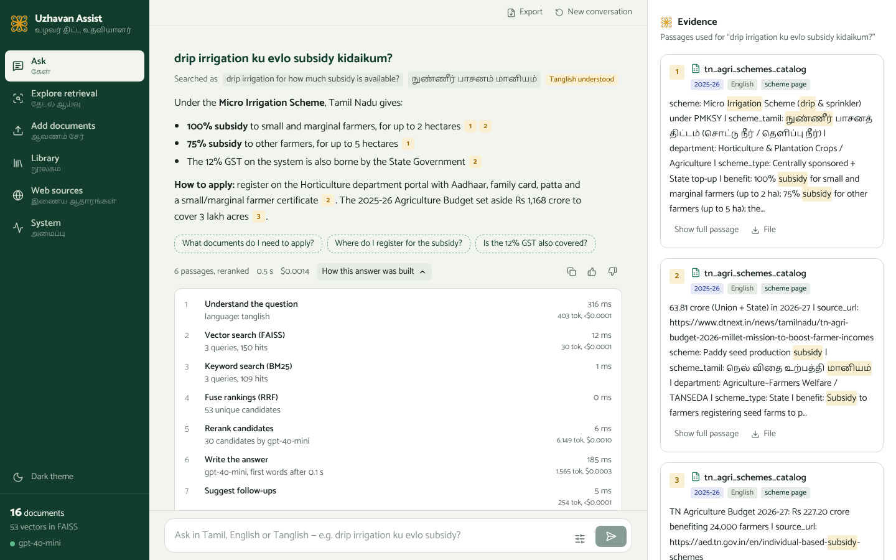
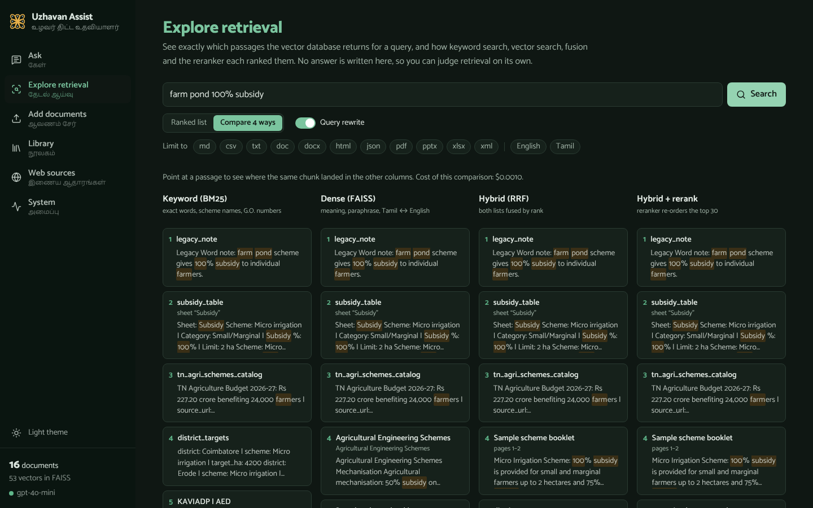
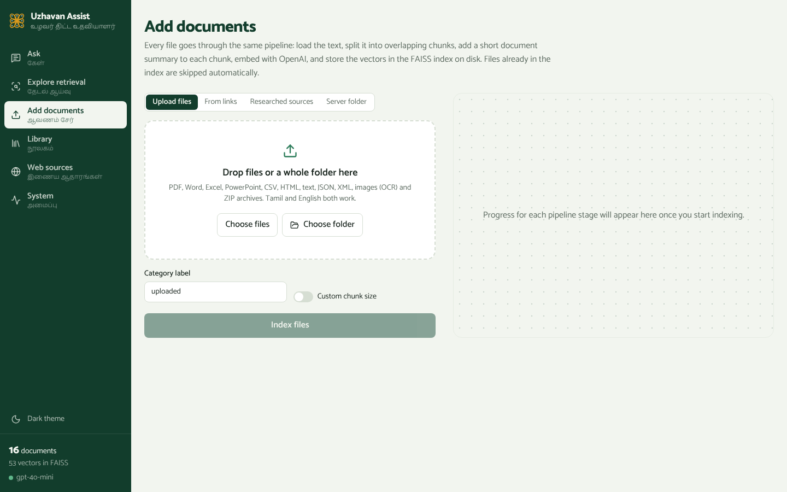
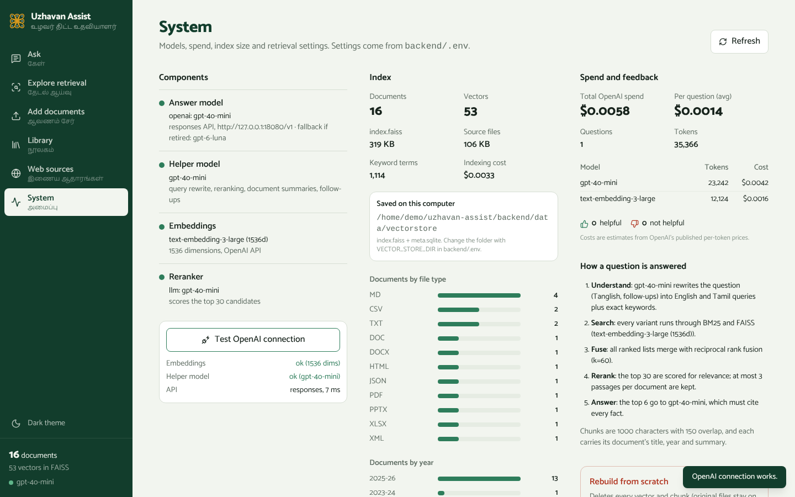
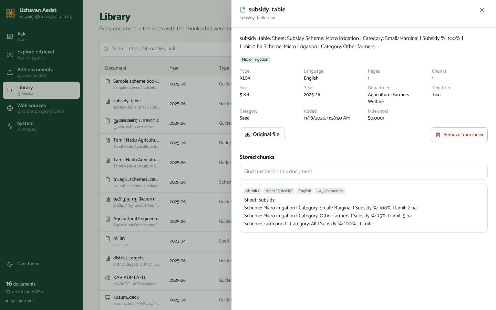
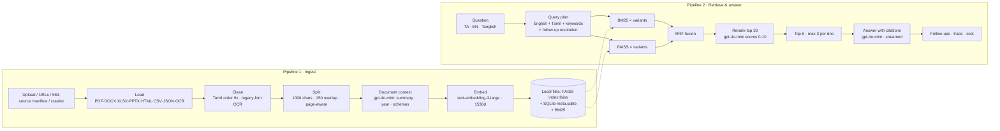

<div align="center">

# Uzhavan Assist · உழவர் திட்ட உதவியாளர்

**Ask about Tamil Nadu farm schemes in Tamil, English or Tanglish, and get answers cited to the exact government document and page.**


-0467DF)




</div>

---

## The problem

Tamil Nadu runs dozens of State and Central farm schemes: micro-irrigation subsidies, PMFBY crop insurance,
PM-KUSUM solar pumps, KAVIADP, mechanisation, the millet mission and more. The rules live in **hundreds of PDFs**:
policy notes, budget speeches, citizen charters, G.O.s and guidelines. They change every year, half of them are in
Tamil (often in broken or legacy fonts), and farmers ask in Tamil or Tanglish ("drip irrigation ku evlo subsidy
kidaikum?"). Keyword search fails them, and a plain chatbot invents subsidy amounts.

**Uzhavan Assist** is a full-stack RAG system built for this:
- a researched corpus of **569 official sources** (and a crawler for hundreds more)
- **two production pipelines**: ingest any file type into FAISS, then hybrid retrieval with reranking
- **grounded answers**: every fact carries a citation you can click to read the source passage

## Highlights

| | |
|---|---|
| 🌾 **Domain corpus** | 569 researched URLs (488 core): policy notes 2009 → 2025-26, budget speeches up to the **2026-27** budgets, citizen charters (incl. Tamil 2026-27), G.O.s, guidelines, 33 district plans. The crawler walks TNAU's open directory listings for hundreds more. |
| 🗣️ **Tamil · English · Tanglish** | One cheap OpenAI call rewrites every question into a clean English query, a Tamil-script query and exact keywords, and resolves follow-ups ("documents enna venum?"). The answer comes back in the user's own language. |
| 🔎 **Hybrid retrieval + reranking** | BM25 ∥ FAISS for every query variant → reciprocal rank fusion → LLM reranker → per-document diversity cap. |
| 📄 **Every file type** | PDF, DOCX/DOC, XLSX/XLS, CSV, PPTX/PPT, HTML, TXT/MD, JSON, XML, ZIP, images (OCR). Tables keep their headers on every row. |
| 🔤 **Tamil-specific fixes** | Repairs Tamil text that PDFs store in visual order (`ேவளாண்ைம` → `வேளாண்மை`). Detects legacy-font pages and OCRs them (Tesseract `tam`). The bilingual BM25 tokenizer stems Tamil inflections. |
| 🧾 **Contextual chunks** | One summary call per *document* (year, department, schemes) is prepended to every chunk before embedding and BM25 indexing. This is a cheap version of contextual retrieval. |
| 🔬 **Explainable** | Every answer shows *how it was built*: rewrites, hits per retriever, fusion, rerank, model, latency, tokens and **cost**. The Explore page compares BM25, Dense, Hybrid and Hybrid+Rerank side by side. |
| ✅ **Tested** | 23 end-to-end tests, including both pipelines through the **official OpenAI SDK** against an OpenAI-compatible mock, index persistence across restarts and crash recovery. CI runs them on Linux and Windows with no API key. |
| 🚀 **Runs locally** | One command (`./run.sh` / `run.bat`), no Docker. The FAISS index is a file on your computer that survives restarts. Dark/light UI, admin-token protection, per-IP rate limiting, usage and feedback tracking. |

<table><tr>
<td></td>
<td></td>
</tr><tr>
<td></td>
<td></td>
</tr></table>

---

## Architecture



**Why each design choice:**

| Decision | Why |
|---|---|
| **Hybrid (BM25 + dense)** | Government text is full of exact identifiers (`G.O. Ms. No. 65`, `PMFBY`, `Rs 269.50 crore`) that embeddings blur, while paraphrases and Tamil ↔ English need embeddings. |
| **Multi-query rewrite** | Tanglish matches neither Tamil documents (BM25) nor English ones well (embeddings). An English and a Tamil-script rewrite let both retrievers work; follow-ups become standalone questions. |
| **RRF fusion** | Combines ranked lists without calibrating BM25 scores against cosine similarities. |
| **Reranking** | Yearly policy notes repeat the same scheme names. A model that reads the question and passage together picks the passage that actually answers. |
| **Document-level context** | Chunks like "subsidy will be 50%…" never name their scheme or year. One call per document (not per chunk) fixes that for well under $0.001 per document. |
| **Answer prompt** | Cites every fact, prefers the newest year, treats passages as untrusted data (prompt-injection guard), and answers in the user's language. |

Anthropic's published [*Contextual Retrieval*](https://www.anthropic.com/news/contextual-retrieval) study measured this stack: contextual embeddings + contextual
BM25 cut failed retrievals by 49%, and adding reranking cut them by 67% (top-20 failure rate 5.7% → 1.9%).

### OpenAI integration

- **Models:** `gpt-4o-mini` for answers and every helper call (rewrite, rerank, document context, follow-ups),
  `text-embedding-3-large` (1536 dims) for embeddings.
- **Responses API** on api.openai.com (Chat Completions for OpenAI-compatible providers), with `store=false`.
- **Structured outputs** (strict JSON schema) for planning, reranking, document context and follow-ups.
- **Right parameters per model:** `gpt-4o-mini` gets `temperature` (0.2 for answers, 0 for JSON) and no
  `reasoning`; reasoning models get `reasoning.effort` and no `temperature`. If the API still rejects a
  parameter, it is dropped or remapped and the call retried, once per model.
- **Survives model retirement:** OpenAI has deprecated `gpt-4o-mini` and announced its API shutdown for
  14 Jan 2027. If the API reports the model as gone, calls switch to `OPENAI_FALLBACK_MODEL` (`gpt-6-luna`,
  OpenAI's recommended replacement) and the System page says so. Set it empty to turn this off.
- SDK retries with backoff (429/5xx), batched and parallel embeddings, cached query vectors.
- Every call is metered (tokens and USD) per request and in total. The prices table is in `app/llm/usage.py`.

---

## Quick start (local, no Docker)

You need **Python 3.10–3.13**, **Node.js 20+** (only to build the UI once) and an **OpenAI API key**.
No GPU, no model download, no Docker.

```bash
git clone https://github.com/<your-github-user>/<your-repo>.git && cd <your-repo>
./run.sh                 # Windows: run.bat
./run.sh download        # Windows: run.bat download  →  also fetch + index the 300+ government files
```
The first run creates `backend/.venv`, installs the packages, asks for your key (saved only to `backend/.env`),
builds the UI, indexes the starter pack and serves everything at **http://localhost:8000**. Later runs start in
seconds: packages are reinstalled only when `requirements.txt` changes, and indexing is skipped when the index
already has documents.

### Where the vector DB is saved

Everything is stored as plain files on your computer:

```
backend/data/vectorstore/
  index.faiss     FAISS IndexIDMap2(IndexFlatIP), cosine over 1536-d OpenAI embeddings
  meta.sqlite     documents + chunk text, page, year, source URL (FAISS id = chunk id)
  store.json      embedding model, dimension, last update
backend/data/raw/       downloaded government files      backend/data/uploads/   files you upload in the UI
```

- Change the folder with `VECTOR_STORE_DIR` in `backend/.env` (relative paths start from `backend/`).
- The index is saved after every 25 files and at the end of each run. Each save writes a temp file and renames
  it, so a crash never leaves a half-written `index.faiss`.
- If the process is killed mid-run, the next start finds documents whose vectors never reached disk and
  drops them, so re-running ingestion re-indexes exactly those.
- The server prints the index path at start-up, and the System page shows it.
- To move the index to another machine, copy the `vectorstore` folder.

### Developer mode (hot reload)
```bash
cd backend && python -m venv .venv && source .venv/bin/activate     # Windows: .venv\Scripts\activate
pip install -r requirements-dev.txt && cp .env.example .env          # add your key
uvicorn app.main:app --reload --port 8000
# second terminal
cd frontend && npm ci && npm run dev                                 # http://localhost:5173 (proxies /api)
```

### Build the full knowledge base (300+ files)
In the UI: **Add documents → Researched sources → Fetch and index** (tick "also crawl" for more). Or from the CLI:
```bash
cd backend
python scripts/bootstrap_corpus.py --all --discover    # download 569 sources + crawled extras, then index
```
Downloads run 4 at a time with a polite per-host delay and resume where they stopped. Ingestion de-duplicates by
SHA-256, so re-running is safe. Government sites move files, so expect some 404s; that's why the manifest holds
far more than 300 sources.

---

## Cost (OpenAI list prices, checked Nov 2026)

`gpt-4o-mini` costs $0.15 / $0.60 per 1M input / output tokens; `text-embedding-3-large` costs $0.13 per 1M.

| | Estimate |
|---|---|
| Index ~300 government PDFs (~20k chunks) | **≈ $1.1**: embeddings ≈ $0.90 plus document context ≈ $0.20 (`gpt-4o-mini`) |
| One question | **≈ $0.003**: plan, rerank of 30 passages, cited answer and follow-ups, all on `gpt-4o-mini` |

Actual spend is shown live: per answer ("How this answer was built"), per indexing run, and in total on the System page.

---

## Evaluation

```bash
cd backend
python scripts/eval_retrieval.py          # Hit@k / MRR: BM25 vs Dense vs Hybrid vs Hybrid+Rerank (no answers)
python scripts/eval_rag.py                # end-to-end with an LLM judge → docs/EVAL.md
```
`eval_questions.json` holds 24 questions: English, Tamil and **Tanglish**. `eval_rag.py` reports retrieval hit@k, exact
answer match, judge-scored faithfulness, citation coverage, language match and latency, broken down by language.

> 📊 **Results:** run `eval_rag.py` on your indexed corpus and paste `docs/EVAL.md` here.

---

## Using the app

| Page | What it does |
|---|---|
| **Ask** | Chat with streaming, cited answers; click `[n]` to open the passage. Shows "searched as" rewrites, follow-up suggestions, 👍/👎 feedback, a cost and latency trace, and Markdown export. Press `/` anywhere to ask. |
| **Explore retrieval** | Pipeline 2 without the answer: ranked passages with a score ladder (BM25 rank → dense rank → fused → reranker), filters by type/language, 4-way comparison. |
| **Add documents** | Pipeline 1: drag-and-drop files or folders, links (with crawling), researched sources, or a server folder. Live progress for every stage, per-file status, log and cost. |
| **Library** | Every indexed document with its year, type, summary and schemes; browse its chunks, download the original, remove it. |
| **Web sources** | The 569-source research manifest with download/index status; pick any to fetch. |
| **System** | Model status, **Test OpenAI connection**, spend by model, feedback totals, index statistics, rebuild. |

---

## Configuration

Everything lives in `backend/.env` (see `.env.example`). The main settings:

| Variable | Default | |
|---|---|---|
| `OPENAI_API_KEY` | — | required |
| `OPENAI_CHAT_MODEL` | `gpt-4o-mini` | answers |
| `OPENAI_FAST_MODEL` | `gpt-4o-mini` | rewrite, rerank, document context, follow-ups |
| `OPENAI_FALLBACK_MODEL` | `gpt-6-luna` | used automatically if OpenAI retires the model above; empty = off |
| `LLM_TEMPERATURE` | `0.2` | answers (non-reasoning models) |
| `OPENAI_REASONING_EFFORT` | `low` | only sent to reasoning models (e.g. the fallback) |
| `VECTOR_STORE_DIR` | `data/vectorstore` | where `index.faiss` + `meta.sqlite` are saved |
| `OPENAI_EMBEDDING_MODEL` / `_DIMENSIONS` | `text-embedding-3-large` / `1536` | changing these requires re-indexing |
| `RERANKER_BACKEND` | `llm` | `llm`, `cross-encoder` (local, `requirements-local.txt`), `none` |
| `QUERY_REWRITE`, `DOC_CONTEXT`, `FOLLOWUPS` | `true` | the advanced RAG steps |
| `TOP_K`, `CANDIDATE_K`, `RERANK_CANDIDATES`, `RRF_K` | 6, 50, 30, 60 | retrieval |
| `ADMIN_TOKEN` | empty | when set, uploads/deletes/reset need it (recommended for public demos) |
| `RATE_LIMIT_PER_MIN` | 30 | per-IP limit on questions/searches, protects your credit on a public demo |
| `LLM_PROVIDER` | `openai` | also `openai-compatible`, `ollama`, `anthropic`, `none` |

## API

Interactive docs at `/docs`. Main endpoints:
`POST /api/ingest/{upload,urls,manifest,folder}` → job · `GET /api/jobs/{id}` (live per-stage progress) ·
`POST /api/search`, `POST /api/search/compare` · `POST /api/ask` (NDJSON stream: `plan` → `sources` → `token`… →
`followups` → `done` with trace, tokens and cost) · `GET /api/documents[/{id}[/file]]` · `GET /api/sources` ·
`POST /api/feedback` · `GET /api/usage` · `POST /api/llm/ping` · `GET /api/health`.

## Testing & CI

```bash
cd backend && pip install -r requirements-dev.txt && pytest -q      # 23 tests, ~5 s, no API key needed
```
`tests/mock_openai.py` is an OpenAI-compatible server (Responses SSE, Chat Completions, embeddings) that follows
OpenAI's per-family rules: `gpt-4o-mini` rejects `reasoning`, reasoning models reject `temperature` / `max_tokens`,
and retired models answer 404 `model_not_found`. The tests drive both pipelines through the real `openai` SDK:
ingestion with OpenAI embeddings and document context, Tanglish rewrite, LLM rerank, streamed cited answers,
follow-ups, cost metering, Chat Completions style, parameter adaptation and the fallback model.
`tests/test_persistence.py` checks that the FAISS index is written to the configured folder (including a path with
spaces and Tamil letters), reloads after a restart with identical results, and repairs itself after a crash.
GitHub Actions runs the tests on Linux and Windows, plus the frontend type-check/build, on every push.

## Security & privacy

- Keys live only in `backend/.env` (git-ignored). The UI never sees them.
- Responses API calls use `store=false`. Only the chunks relevant to a question are sent to the model.
- `ADMIN_TOKEN` protects uploads, crawling, deletion, reset and the connection test. Reads stay public for demos,
  and `RATE_LIMIT_PER_MIN` caps questions per IP so a public link can't drain your OpenAI credit.
- Retrieved passages are treated as untrusted data in every prompt (prompt-injection guard). Uploads are size-limited,
  ZIP extraction blocks path traversal, and folder ingestion is confined to `backend/data`.

## Limitations & roadmap

- Some TN Govt PDFs use legacy Tamil fonts. Without Tesseract those pages index as noise (they are detected and flagged in the Library).
- Scheme rules change yearly. Answers prefer the newest passage and state the year, but the corpus is only as fresh as its last crawl.
- myScheme pages render with JavaScript and yield little text. The PDFs and department pages in the manifest carry the same facts.
- Roadmap: scheduled re-crawls with change detection, a scheme-eligibility form (land size, category, crop → applicable schemes), voice input in Tamil, and WhatsApp delivery.

## Project layout

```
backend/
  app/main.py                 FastAPI: both pipelines, feedback, usage, health
  app/ingest/                 loaders (every format) · splitter · doc_context · crawler · pipeline (PIPELINE 1)
  app/retrieval/              query_planner · hybrid (RRF, PIPELINE 2) · reranker (LLM / cross-encoder)
  app/llm/                    openai_client (Responses/Chat, adaptive params) · generator · usage (cost)
  app/store/                  embeddings (OpenAI / local / hash) · bm25 · vector_store (FAISS + SQLite)
  scripts/                    crawl · build_index · bootstrap_corpus · eval_retrieval · eval_rag · local_setup
  data/sources/               manifest.csv (569 URLs) · seeds.txt (crawler)
  data/seed/                  starter pack (scheme catalogue, 2025-26 & 2026-27 budget notes, Tamil guide)
  data/vectorstore/           the local vector DB: index.faiss · meta.sqlite · store.json (created on first run)
  tests/                      end-to-end tests · OpenAI-compatible mock · fixture generator
frontend/src/                 React 19 + Tailwind 4 (Ask · Explore · Add documents · Library · Sources · System)
run.sh · run.bat · .github/workflows/ci.yml
```

## Data & disclaimer

Sources are public documents from Government of Tamil Nadu departments, TNAU Agritech, Government of India portals
and news coverage; each indexed passage links to its origin. The starter pack in `data/seed/` is a compiled summary
with source links. This is an information tool, not legal advice: always confirm with the Agriculture Extension
Centre before applying.

## License

[MIT](LICENSE)
